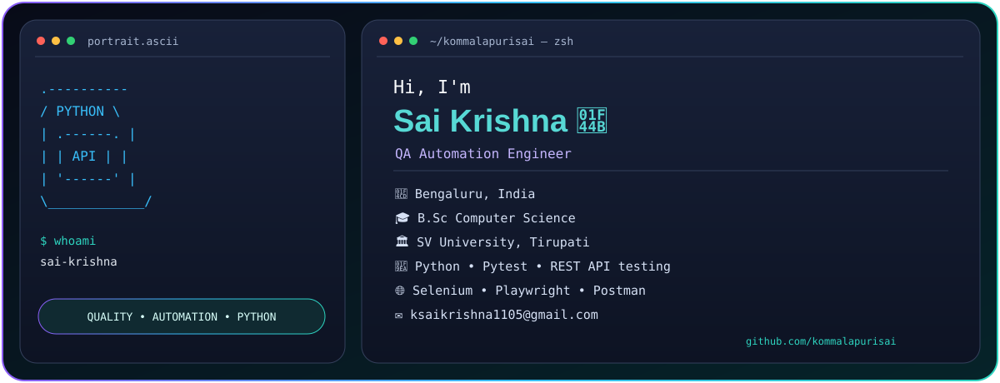

### QA Automation Engineer | Python | API & UI Test Automation

Building reliable, maintainable automation frameworks for web applications and REST APIs.

---

## 👨‍💻 About Me

- QA Automation Engineer focused on Python-based test automation.
- Interested in REST API testing, UI automation, and framework engineering.
- Working with Python, Pytest, Selenium WebDriver, and Playwright.
- Focused on reusable code, meaningful assertions, reliable execution, and clear test reports.
- Continuously learning CI/CD practices and AI-powered testing.

## 🛠️ Tech Stack

**Programming:** Python

**API Testing:** REST APIs, Requests, Postman, JSON, response validation

**Test Frameworks:** Pytest, unittest,Robot framework,Hybrid Framework (Combination of BDD & DDT)

**UI Automation:** Selenium WebDriver, Playwright

**CI/CD & Tools:** Git, GitHub Actions, Jenkins, Docker

**Additional Skills:** SQL, Linux, HTML, CSS, Allure Reports, HTML Reports

## 🚀 Featured Projects

### 1. Python API Automation Framework
A reusable API automation framework using Python, Requests, and Pytest.

Planned capabilities:
- GET, POST, PUT, PATCH, and DELETE request coverage
- Status code, response body, headers, and schema validation
- Positive, negative, and boundary test scenarios
- Reusable API client and fixtures
- Environment-based configuration without committing secrets
- HTML/Allure reports and GitHub Actions execution

> Add the repository link and mark features as complete only after implementing and testing them.

### 2. REST API Test Scenarios
A documented collection of CRUD, invalid-payload, authentication, and error-handling test cases.

### 3. UI Automation Framework
A Python-based Selenium/Playwright project demonstrating reusable fixtures, page objects, synchronization, and failure screenshots.

## 📚 Currently Learning

- Advanced API automation and contract testing
- CI/CD for automated test execution
- Docker-based test environments
- AI application and LLM testing

## 🤝 Connect

- GitHub: [kommalapurisai](https://github.com/kommalapurisai)
- LinkedIn: Add your LinkedIn profile URL
- Email: Add your professional contact email

---

**Quality is built into the process, not just checked at the end.**

