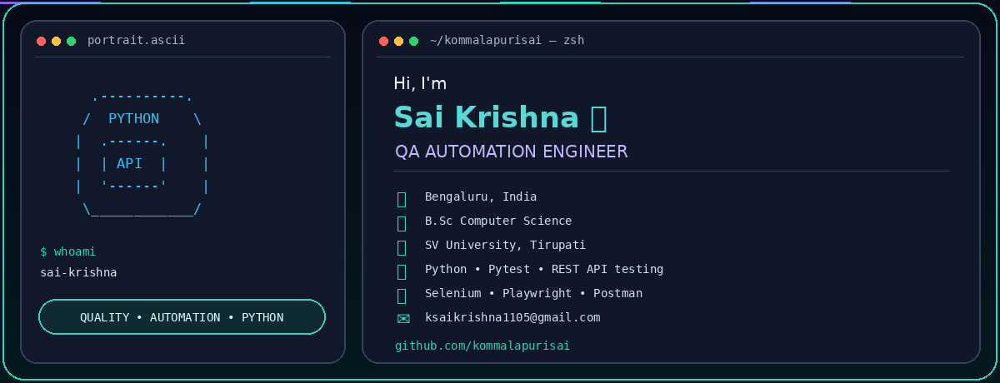

### QA Automation Engineer | Python | API & UI Test Automation

Building reliable, maintainable automation frameworks for web applications and REST APIs.

---

## 👨‍💻 About Me

- QA Automation Engineer focused on Python-based test automation.
- Interested in REST API testing, UI automation, and framework engineering.
- Skills: Python, Pytest, Selenium WebDriver, Playwright, and Postman.
- Focused on reusable code, meaningful assertions, reliable execution, and clear test reports.

## 🎓 Education

- **Degree:** B.Sc Computer Science
- **University:** SV University, Tirupati

## 🛠️ Tech Stack

**Programming:** Python  
**API Testing:** REST APIs, Requests, Postman, JSON and response validation  
**Test Frameworks:** Pytest, unittest  
**UI Automation:** Selenium WebDriver, Playwright  
**CI/CD & Tools:** Git, GitHub Actions, Jenkins, Docker  
**Additional:** SQL, Linux, HTML, CSS, Allure Reports

## 🚀 Featured Projects

### Python API Automation Framework
A project for testing REST APIs with Python, Requests, and Pytest.

Planned capabilities:
- GET, POST, PUT, PATCH, and DELETE
- Status code, response body, and header validation
- Positive, negative, and boundary scenarios
- Reusable API clients and fixtures
- Environment-based configuration
- CI execution and test reports

### UI Automation Framework
A Python-based UI testing project using Selenium or Playwright and Pytest.

> Add links to your repositories and describe features as completed only after implementing and testing them.

## 📚 Currently Learning

- Advanced API automation and contract testing
- CI/CD for automated test execution
- Docker-based test environments
- AI application testing

## 🤝 Contact

- **Email:** [ksaikrishna1105@gmail.com](mailto:ksaikrishna1105@gmail.com)
- **GitHub:** [kommalapurisai](https://github.com/kommalapurisai)
- **Location:** Bengaluru, India

---

**Quality is built into the process, not just checked at the end.**

